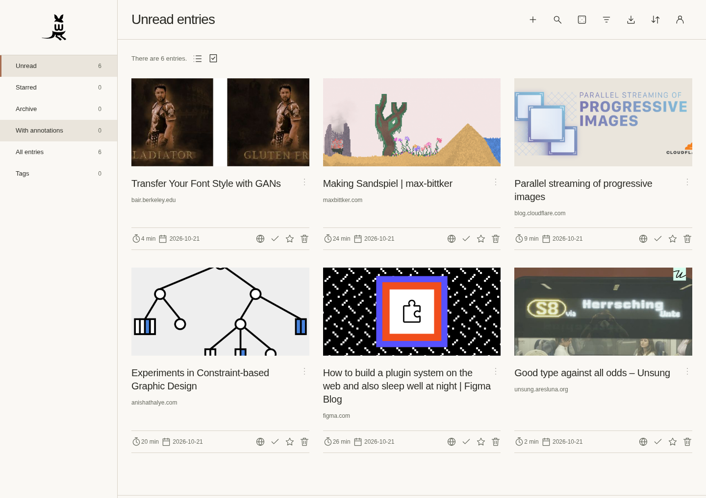

# wallabag for Sandstorm

[wallabag](https://wallabag.org/) saves web articles for later reading. This
repository packages it for [Sandstorm](https://sandstorm.org/), with Sandstorm
sign-in, shared libraries, and permission-controlled website access.

Each Sandstorm grain is one reading library. Collaborators share full access,
including deletion and export. The package includes background imports, a browser
extension, private RSS feeds, and light, dark, and automatic themes.



## Getting started

Open the wallabag app in Sandstorm and create a reading library. Save a URL and
approve website access when Sandstorm prompts you. Keep the library open while
imports need access to new sites; previously approved sites work in the background.
Failed imports can be retried from **Import → Retry unsuccessful entries**.

- **Browser extension:** Open **Account → Browser extensions** for Chrome/Chromium
  and Firefox development downloads, installation instructions, and connection
  credentials. See [the extension guide](extension/README.md) for details.
- **RSS:** Open **RSS subscriptions** in the account menu, choose a feed, and
  create subscription credentials. Your reader must support authenticated feeds.
  Feed reader credentials allow access to feeds only, not the library UI.
- **Appearance:** Choose **Light**, **Dark**, or **Automatic** from the account
  menu or the reader's appearance menu. Preferences are saved per Sandstorm user.

## Development

Install `spktool`, Lima, and Node.js 22+ on the host, then run:

```sh
spktool vm up
extension/build.sh
spktool dev
```

Open http://local.sandstorm.io:6091, sign in with a local Dev account, and choose
**Apps → wallabag**. Keep `spktool dev` running while testing.

See [DEVELOPMENT.md](DEVELOPMENT.md) for VM setup, integration details, packaging
and upgrades, tests, and patch maintenance.

## Limitations

This package is a prototype. Unmodified mobile apps and browser extensions are
not yet integrated, and there is no read-only library UI role. Native account
management and public article sharing are disabled in favor of Sandstorm access
controls. Reloading articles and each upstream import format need more end-to-end
testing with Powerbox.

Back up grains before testing upgrades: migrations run forward, and automatic
downgrade is not supported.

## License

Original integration code is [MIT licensed](LICENSE). Bundled projects retain
their own licenses.
